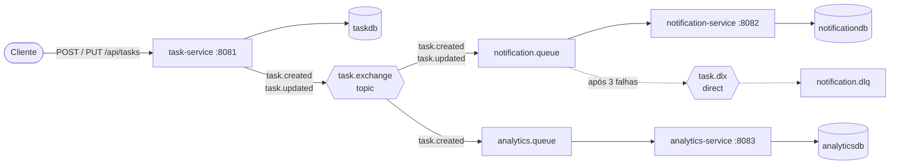

# Sistema de Gestão de Tarefas com EDA — Documentação

Disciplina: Sistemas Baseados em Eventos e Mensageria Distribuída
Pós-Graduação em Arquitetura de Sistemas Escaláveis
Autor: Rodolfo Delfini

Stack: Java 21, Spring Boot 3.3.5, Spring AMQP, Spring Data JPA, H2, RabbitMQ 3 (Docker).

---

## 1. Introdução

O exercício é um sistema de tarefas em que a criação de uma tarefa precisa disparar duas ações secundárias: avisar o responsável e atualizar as estatísticas do dia.

Se o serviço de tarefas chamasse os outros dois por HTTP, a requisição do usuário ficaria esperando as duas chamadas terminarem, e bastaria um dos serviços estar fora do ar para a criação da tarefa falhar. Além disso, cada novo interessado no evento exigiria mexer no código do serviço de tarefas.

Com eventos, o serviço de tarefas só grava a tarefa e publica um `TASK_CREATED` no RabbitMQ. Quem tiver interesse consome a sua própria fila, no seu próprio ritmo. Se um consumidor estiver parado, as mensagens ficam na fila até ele voltar.

Objetivos:

- separar três responsabilidades em serviços independentes (tarefas, notificações e métricas);
- comunicar os serviços apenas por mensagens, sem chamadas diretas entre eles;
- não perder eventos quando um consumidor falha, e não contar o mesmo evento duas vezes.

---

## 2. Arquitetura

### 2.1. Componentes e fluxo



### 2.2. Serviços

**task-service (8081)** — produtor. Expõe a API de tarefas, grava no H2 e publica `TASK_CREATED` (no `POST`) e `TASK_UPDATED` (no `PUT`) na `task.exchange`. Não sabe quem consome os eventos.

**notification-service (8082)** — consome a `notification.queue`, que recebe criações e atualizações. Simula o envio: tarefa `CRITICAL` vai por SMS, as demais por e-mail. O envio é só um log, mas cada notificação fica gravada no banco e pode ser consultada pela API.

**analytics-service (8083)** — consome a `analytics.queue`, que recebe só criações. Mantém uma linha por dia com o total de tarefas e a contagem por prioridade. Antes de contar, verifica se o `eventId` já foi processado.

### 2.3. Ordem de inicialização

As filas e os bindings são declarados pelos consumidores. Por isso, `analytics-service` e `notification-service` devem subir antes do `task-service`. Se o produtor publicar antes de as filas existirem, a exchange descarta a mensagem por não ter destino.

---

## 3. Decisões técnicas

### 3.1. RabbitMQ

Era o broker pedido no exercício, e se encaixa bem no caso: o modelo de exchanges e bindings resolve o roteamento sem código nos serviços, as filas duráveis, junto com o ack enviado só depois que o listener termina sem erro, garantem entrega at-least-once, e o painel de gerenciamento ajuda bastante a acompanhar o que está acontecendo durante os testes.

### 3.2. Exchanges

São usados dois tipos:

- **Topic** (`task.exchange`), para os eventos de negócio. Uma direct resolveria o cenário atual, mas a topic deixa o caminho aberto para assinaturas por padrão. Por exemplo, uma fila só para tarefas críticas com `task.created.critical`, ou uma de auditoria com `task.#`, sem mudar nada nos consumidores existentes.
- **Direct** (`task.dlx`), como dead letter exchange. Ela só recebe as mensagens rejeitadas pela `notification.queue`, com uma routing key fixa, então não há necessidade de padrões.

### 3.3. Formato das mensagens

JSON via `Jackson2JsonMessageConverter`. Além de legível no painel do RabbitMQ, não amarra os consumidores a Java. O conversor envia no header `__TypeId__` o nome da classe do evento, e é isso que permite ao `notification-service` ter um método para `TaskCreatedEvent` e outro para `TaskUpdatedEvent` na mesma fila (`@RabbitHandler`).

Para essa conversão funcionar, as classes de evento estão copiadas nos três serviços, no mesmo pacote `com.example.task.event`, como o guia propõe. Em um projeto maior, elas iriam para um módulo compartilhado, ou o mapeamento de tipos seria configurado para não depender do nome da classe.

### 3.4. Banco por serviço

Cada serviço tem o seu arquivo H2 em `./data` e nenhum lê o banco do outro. O que um consumidor precisa saber sobre a tarefa vem dentro do evento.

### 3.5. Retry e Dead Letter Queue

No `notification-service`, uma exceção durante o processamento dispara até 3 tentativas, com espera de 1s e depois 2s. Se ainda falhar, a mensagem é rejeitada sem requeue (`default-requeue-rejected=false`) e o RabbitMQ a encaminha para a `task.dlx`, que entrega na `notification.dlq`. Lá ela fica disponível para análise, com o header `x-death` indicando a origem e o motivo.

Mensagens que nem chegam a ser convertidas (JSON inválido) são tratadas como erro fatal e vão direto para a DLQ, porque tentar de novo não mudaria o resultado.

Sem essa configuração, o padrão do Spring AMQP é devolver a mensagem para a fila a cada exceção. Na prática, isso vira um loop de reentrega e a DLQ nunca é usada.

### 3.6. Idempotência

O RabbitMQ garante que a mensagem é entregue pelo menos uma vez, o que inclui a possibilidade de entregá-la de novo (por exemplo, se o consumidor processou mas caiu antes de mandar o ack). No analytics, isso inflaria as contagens.

Cada evento carrega um `eventId` (UUID gerado no produtor). O `analytics-service` grava esse id na tabela `processed_events` na mesma transação em que atualiza a métrica, e descarta qualquer evento cujo id já esteja lá.

### 3.7. Tratamento de erros na API

O `task-service` responde `400` quando falta o título, `404` para tarefa inexistente e `503` se não conseguir publicar no RabbitMQ. Como a publicação acontece dentro da transação, nesse último caso a tarefa também não é gravada. Os erros seguem o formato `ProblemDetail` do Spring.

### 3.8. Limitações conhecidas

- O `notification-service` não é idempotente. Uma mensagem reentregue gera uma segunda notificação. A solução seria a mesma do analytics.
- Publicar dentro da transação evita gravar a tarefa sem evento, mas não cobre o caso contrário: se o commit falhar depois da publicação, o evento já saiu. O tratamento completo seria o padrão Transactional Outbox, que ficou fora do escopo do exercício.

---

## 4. Eventos

Campos comuns (classe `TaskEvent`):

| Campo | Tipo | Descrição |
|---|---|---|
| `eventId` | String (UUID) | Identificador único, usado na deduplicação |
| `eventType` | String | `TASK_CREATED` ou `TASK_UPDATED` |
| `taskId` | Long | Id da tarefa no task-service |
| `timestamp` | LocalDateTime | Momento em que o evento foi gerado |

### TASK_CREATED

Routing key `task.created`. Vai para `notification.queue` e `analytics.queue`.

| Campo | Descrição |
|---|---|
| `title` | Título da tarefa |
| `description` | Descrição (opcional) |
| `assignee` | Responsável |
| `priority` | `LOW`, `MEDIUM`, `HIGH` ou `CRITICAL` |

```json
{
  "eventId": "f47ac10b-58cc-4372-a567-0e02b2c3d479",
  "eventType": "TASK_CREATED",
  "taskId": 1,
  "timestamp": "2026-11-20T18:36:22",
  "title": "Implementar EDA",
  "description": "Teste do fluxo",
  "assignee": "Joao Silva",
  "priority": "HIGH"
}
```

### TASK_UPDATED

Routing key `task.updated`. Vai só para `notification.queue`. Tem os mesmos campos do `TASK_CREATED` mais o `status` (`PENDING`, `IN_PROGRESS`, `DONE` ou `CANCELLED`), sempre com o estado completo da tarefa depois da alteração.

```json
{
  "eventId": "8e3c12a4-1234-4bc1-9012-7890abcdef12",
  "eventType": "TASK_UPDATED",
  "taskId": 1,
  "timestamp": "2026-11-20T18:40:10",
  "title": "Implementar EDA",
  "description": "Teste do fluxo",
  "assignee": "Joao Silva",
  "priority": "HIGH",
  "status": "DONE"
}
```

---

## 5. Endpoints

### task-service (8081)

| Método | Caminho | Descrição | Respostas |
|---|---|---|---|
| POST | `/api/tasks` | Cria a tarefa e publica `TASK_CREATED` | 201, 400, 503 |
| GET | `/api/tasks` | Lista todas as tarefas | 200 |
| GET | `/api/tasks/{id}` | Busca uma tarefa | 200, 404 |
| PUT | `/api/tasks/{id}` | Altera os campos enviados e publica `TASK_UPDATED` | 200, 404, 503 |

Exemplo de corpo do `POST`:

```json
{ "title": "Implementar EDA", "description": "Teste do fluxo", "assignee": "Joao Silva", "priority": "HIGH" }
```

Se a prioridade não for informada, a tarefa é criada como `MEDIUM`. O status inicial é sempre `PENDING`. No `PUT`, só os campos presentes no corpo são alterados, por exemplo `{"status": "DONE"}`.

### notification-service (8082)

| Método | Caminho | Descrição |
|---|---|---|
| GET | `/api/notifications` | Todas as notificações registradas |
| GET | `/api/notifications/{id}` | Uma notificação |
| GET | `/api/notifications/task/{taskId}` | Notificações de uma tarefa |

### analytics-service (8083)

| Método | Caminho | Descrição |
|---|---|---|
| GET | `/api/metrics` | Métricas de todos os dias |
| GET | `/api/metrics/today` | Métricas do dia (204 se ainda não houver nenhuma) |

Os três serviços também têm o console do H2 em `/h2-console` (usuário `sa`, sem senha).

---

## 6. Configuração

### 6.1. RabbitMQ

O `docker-compose.yml` sobe a imagem `rabbitmq:3-management-alpine` com o usuário `admin`/`admin`, as portas `5672` (AMQP) e `15672` (painel) e um volume para os dados do broker.

```bash
docker compose up -d
```

Exchanges, filas e bindings não são criados no compose. Cada consumidor os declara ao subir, pelas classes `RabbitMQConfig`.

### 6.2. Serviços

As configurações ficam no `application.properties` de cada serviço:

| Propriedade | task | notification | analytics |
|---|---|---|---|
| `server.port` | 8081 | 8082 | 8083 |
| `spring.datasource.url` | `./data/taskdb` | `./data/notificationdb` | `./data/analyticsdb` |
| fila consumida | — | `notification.queue` | `analytics.queue` |
| bindings | — | `task.created`, `task.updated` | `task.created` |

O retry fica só no `notification-service`:

```properties
spring.rabbitmq.listener.simple.retry.enabled=true
spring.rabbitmq.listener.simple.retry.max-attempts=3
spring.rabbitmq.listener.simple.retry.initial-interval=1000
spring.rabbitmq.listener.simple.retry.multiplier=2.0
spring.rabbitmq.listener.simple.retry.max-interval=5000
spring.rabbitmq.listener.simple.default-requeue-rejected=false
```

O passo a passo de execução e os testes estão no [README](../README.md).
